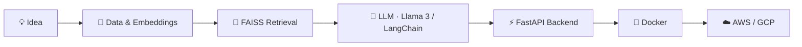

 

  

 

## 👋 About Me

<table>
<tr>
<td width="60%" valign="top">

I'm an **AI & Data Science graduate (B.Tech, 2026)** who builds practical **AI/ML and GenAI applications**.

Through two internships I've worked on LLM chatbots, RAG pipelines and ML models. I enjoy taking an idea all the way from **prototype → AI pipeline → API → deployable app**.

📝 Published author: conference paper at **ICNKAI-2K25**
🎯 Looking for **entry-level AI/ML & GenAI Engineer** roles

</td>
<td width="40%" valign="top">

**⚡ What I'm working with**

🔎 RAG with **Llama 3 (Ollama), LangChain, FAISS**
🧠 Multi-step agents with **LangGraph**
🚀 APIs with **FastAPI**, shipped via **Docker**
☁️ Cloud on **AWS / GCP**

</td>
</tr>
</table>

 

## 🧠 How I Build

 

## 🚀 Featured Projects

<table>
<tr>
<td width="50%" valign="top">

### 🏛️ SchemeSense
**AI-Powered SmartGov Scheme Advisor** · *Final Year Project*

<a href="https://github.com/Prabanchan-Arul/RAG_APP">
<picture>
  <source media="(prefers-color-scheme: dark)" srcset="https://github-readme-stats.vercel.app/api/pin/?username=Prabanchan-Arul&repo=RAG_APP&theme=github_dark&hide_border=true&title_color=38BDF8&icon_color=38BDF8">
  
</picture>
</a>

Scheme eligibility rules are full of jargon, so people miss schemes they qualify for. SchemeSense explains them in plain language.

- 🔎 **Llama 3 (Ollama) RAG** simplifies eligibility criteria
- 🖥️ **React.js + FastAPI + MySQL** full-stack app
- 🎯 **Rule engine + Scikit-learn** recommender
- 🌐 **Multilingual** support + **Twilio** integration

</td>
<td width="50%" valign="top">

### 🕷️ AI Scraping Research Agent
**Multi-tool agent built with LangGraph**

<a href="https://github.com/Prabanchan-Arul/AI_AGENT1">
<picture>
  <source media="(prefers-color-scheme: dark)" srcset="https://github-readme-stats.vercel.app/api/pin/?username=Prabanchan-Arul&repo=AI_AGENT1&theme=github_dark&hide_border=true&title_color=38BDF8&icon_color=38BDF8">
  
</picture>
</a>

A research agent that orchestrates multiple tools through a **LangGraph** workflow.

- 🧠 Multi-step agent flow with **LangGraph**
- 🛠️ Tool-calling for scraping and research tasks

</td>
</tr>
<tr>
<td colspan="2" valign="top">

### 📄 AI-Powered Resume–Job Matching System

Keyword-only ATS screening rejects qualified candidates over literal mismatches. This system matches on **meaning** instead.

- 🧠 **LangChain + Llama 3 + FAISS** semantic similarity search with LLM reasoning
- ⚡ **FastAPI** RESTful backend with a **Streamlit** frontend
- 📊 Real-time **gap analysis** between a resume and a job description, so candidates see why they match or don't

</td>
</tr>
</table>

 

## 🛠️ Tech Stack

| | |
| :-- | :-- |
| **Languages** |  |
| **ML & Data** |      |
| **GenAI & LLMs** |       |
| **Backend & Cloud** |  |
| **Tools** |  |

 

## 💼 Experience

| Period | Role | What I did |
| :-- | :-- | :-- |
| **Dec 2025 – Feb 2026** | **AI/ML Intern** BETA Softnet (OPC) Pvt Ltd | Built LLM chatbots with **LangChain & LangGraph** for context-aware, multi-step reasoning with less human involvement. Deployed LLM predictions via **FastAPI** REST APIs and built a **Scikit-learn** classification model. |
| **Jul 2025 – Sep 2025** | **Data Science Intern** Top Tech Developers | End-to-end data analysis and modeling in **Python** on real-world datasets. Built pre-processing and visualization pipelines to improve data quality for ML tasks. |

 

## 🎓 Education & 📝 Publication

<table>
<tr>
<td width="50%" valign="top">

**B.Tech — Artificial Intelligence & Data Science**
Sriram Engineering College
Nov 2022 – May 2026 · **CGPA: 8.6 / 10**

</td>
<td width="50%" valign="top">

**Building Bridges: An Intelligent Platform to Connect Alumni and Students in Technical Education**
ICNKAI-2K25 · 2025

</td>
</tr>
</table>

<b>📜 Certifications</b>

 

 

## 📈 GitHub Activity

<picture>
  <source media="(prefers-color-scheme: dark)" srcset="https://github-readme-stats.vercel.app/api?username=Prabanchan-Arul&show_icons=true&theme=github_dark&hide_border=true&title_color=38BDF8&icon_color=38BDF8&rank_icon=github">
  
</picture>
<picture>
  <source media="(prefers-color-scheme: dark)" srcset="https://github-readme-stats.vercel.app/api/top-langs/?username=Prabanchan-Arul&layout=compact&theme=github_dark&hide_border=true&title_color=38BDF8">
  
</picture>

 

<picture>
  <source media="(prefers-color-scheme: dark)" srcset="https://streak-stats.demolab.com/?user=Prabanchan-Arul&theme=github-dark-blue&hide_border=true">
  
</picture>

 

  

 

## 🎯 Current Goals

| 🤖 AI | ⚙️ Engineering | 💼 Career |
| :-- | :-- | :-- |
| Build production-ready RAG systems | Build scalable FastAPI services | AI/ML Engineer |
| Explore advanced agent architectures | Level up cloud deployment (AWS / GCP) | GenAI Engineer |
| Ship reliable LLM applications | Learn production AI infrastructure | Junior AI Engineer |

 

### 💡 Building AI systems that turn ideas into useful products.

